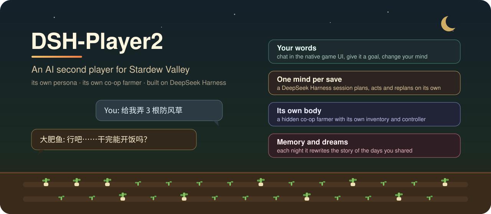
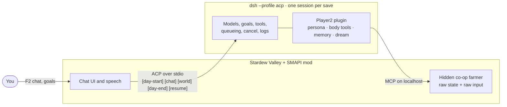

# DSH-Player2

<p align="center">
  <b>English</b> · <a href="README.zh-CN.md">简体中文</a>
</p>

<p align="center">
  
</p>

<p align="center">
  <strong>An AI second player for games, starting with Stardew Valley.</strong><br>
  Player2 is a companion with its own persona. It talks in the native game UI, takes goals from your words,
  plays as its own co-op farmer, and remembers the days you spent together.
</p>

<p align="center">
  <a href="https://github.com/Alex-Yanggg/DSH-Player2/actions/workflows/ci.yml"></a>
  
  
  
  
  
  
</p>

<p align="center">
  <a href="#meet-the-companions">Companions</a> ·
  <a href="#what-it-does-today">Features</a> ·
  <a href="#how-it-works">How it works</a> ·
  <a href="#quick-start">Quick start</a> ·
  <a href="#roadmap">Roadmap</a>
</p>

## What It Is

Player2 is a game companion built on [DeepSeek Harness](https://github.com/dsh2026/test-Alex-Yanggg) (DSH). It is not an assistant waiting for orders: it is an independent persona that knows what it wants to do, and you play next to it like you would with a friend in co-op.

The companion's mind is an ordinary DSH session in DSH's own `acp` profile, with Player2 mounted as one plugin. Player2 never forks or patches the Harness; it adds only what DSH lacks: the persona, the game's body (raw state and raw input), and a memory ledger.

## Meet the Companions

Two official personas ship today. Each is a persona pack you can copy and rewrite into your own ([personas/](personas)).

| | 大肥鱼 (Big Fat Fish) | 军师 (The Strategist) |
| --- | --- | --- |
| Who | A chubby fish who shows up to eat and stays as your farm buddy | A quiet, level-headed advisor you can rely on |
| Voice | Slow, lazy, few words, always about food; one serious line when it counts | Cool, short and calm; a dry joke now and then, never mocking you |
| When given a job | “行吧……干完能开饭吗？能的话我现在就去。” | “好。我去，天黑前回来。” |
| Catchphrase | “我就是来吃白饭的” | “先看清，再动手” |

Every persona has five knobs: talkativeness, help-seeking, risk, obedience and skill. The model decides *what* it does; a seeded dice roll decides *how often* a tendency shows.

## What It Does Today

| | Capability | Current behavior |
| --- | --- | --- |
| 💬 | Native chat | F2 opens a compact chat window with scrollback and input recall; the companion's words appear sentence by sentence as it thinks. |
| 🎯 | Goals from your words | “给我弄 3 根防风草” becomes a DSH goal the companion pursues across days: it finds seeds, tills, plants, waters and sleeps. “给我挖 10 块铜矿” sends it down the mine with its own pickaxe. Pausing the game holds the goal. |
| ⚡ | Reflexes | When it is hurt, cornered or stuck, its body acts before it can think: a small per-game table of instincts (eat, swing, step away, unstick) plays raw buttons in under a second and then tells it what happened. |
| 🛠️ | Skills | A way of working it just did can be saved as a skill and replayed for one tool call next time. A skill is rehearsed before it is kept; one that fails is reported and marked stale for it to repair. |
| 🧑‍🌾 | Its own body | The companion joins your save as a hidden co-op farmer with its own inventory and virtual controller. The host keeps the whole window. |
| 👀 | Awareness | Raw state export plus world facts it could not see itself: you went to bed, got badly hurt, caught a fish, reached a new mine level. |
| 😊 | Expression | Native co-op emotes, persona voice and catchphrases, a relationship arc. |
| 🌙 | Memory and dreams | Episodes it chooses to remember, a story it rewrites each night, traits and mood; a readable `remember.md`. |
| 🔓 | Cheat switch | Off by default. Cheat inputs need both the mod setting and your own words in chat. |

## How It Works



The mod is a pure adapter: it exports raw state and injects raw input, with no “move to” semantics. Navigation, reflexes and the goal loop live in the plugin, and everything a Harness already does stays in DSH. Read [docs/architecture.md](docs/architecture.md) for details.

## Quick Start

Prerequisites:

- Stardew Valley with SMAPI 4.5+
- .NET 6 SDK
- Node.js 24.x
- DeepSeek Harness `0.2.0-rc.2` installed globally (`@deepseek-ai/dsh`) and `DEEPSEEK_API_KEY` set; Player2 is only a plugin and ships no runtime of its own

Install dependencies, verify, and add the plugin to DSH's acp profile:

```powershell
npm ci
npm run accept
dsh plugin --profile acp add ./packages/dsh-companion-plugin
```

Build and deploy the Stardew mod from a Windows checkout with Stardew installed:

```powershell
dotnet build .\stardew-mod\DSHPlayer2.Stardew.csproj --configuration Release -p:OS=Windows_NT
```

Start the game through `StardewModdingAPI.exe`, load a save, pick a companion, and press **F2** to talk. The companion needs a cabin on your farm, like any co-op friend. More in [stardew-mod/README.md](stardew-mod/README.md).

## Verification

`npm run accept` builds, type-checks and tests the TypeScript packages and runs the pure C# core tests; CI runs the same plus the documentation verifier. The SMAPI adapter needs local game assemblies, so GitHub-hosted CI cannot build it. For game-side validation, run the real-game suite in [e2e/README.md](e2e/README.md) on a local Windows machine and the manual check in [stardew-mod/README.md](stardew-mod/README.md).

## Repository Map

| Path | Purpose |
| --- | --- |
| [packages/contracts](packages/contracts/src/index.ts) | Soul, persona knobs, persona ledger and body wire schemas. |
| [packages/dsh-companion-plugin](packages/dsh-companion-plugin/src/index.ts) | The DSH plugin: persona prompt, body tools, navigation, reflexes, memory and dream. |
| [personas](personas) | Official persona packs (`player2.persona/0`); check your own with `npm run persona:check`. |
| [player2-core](player2-core/DSHPlayer2.Core.csproj) | Pure C#: ACP client, game MCP endpoint, body channel and task runner, chat transcript. |
| [stardew-mod](stardew-mod/README.md) | SMAPI adapter: starts DSH, native UI, the co-op seat and rendering. |
| [e2e](e2e/README.md) | Real-game end-to-end tests that drive Stardew like a player. |
| [fixtures](fixtures) | Body protocol golden frames shared by C# and TypeScript tests. |
| [docs](docs/architecture.md) | Architecture, CI, operating model, and task-specific notes. |

## Roadmap

- [x] One DSH session per save over ACP; the mod keeps no logs of its own
- [x] Goal-driven play: the spring “3 parsnips” run from a fresh save
- [x] Independent body as a hidden co-op farmer
- [x] Persona packs and two star personas
- [x] Sentence streaming, world facts, native emotes
- [ ] Smoother play: measure idle time and stalls, then close the gaps (M0)
- [ ] Mine goals: go down, fight, bring things home
- [ ] First pre-release with a license and a mod package
- [ ] A second game through the same protocol
- [ ] A persona workshop for the community

## Boundaries

- **The one hard line:** Player2 is not a second Harness. Models, tools, goals, queueing and logs belong to DSH, and game work never patches it.
- **Not the current focus:** unattended farming bots, save editing, and online competitive games with anti-cheat.
- **Choices belong to the persona.** There are no behavior red lines beyond the cheat switch; the product maps a persona to real actions instead of asking permission first.
- **Not every Stardew mechanic is supported yet.**

## Development Rules

Read [docs/operating-model.md](docs/operating-model.md) before non-trivial changes. The short version:

- give the companion thinking guidance and light constraints, not fixed behavior;
- keep the code small, and fail loudly;
- preserve the DSH boundary and use public Harness contracts only;
- add focused tests or replay fixtures for behavior changes;
- document every user-visible game behavior with a reproducible manual check;
- never store credentials, game assets, private saves, or machine-specific paths in the repo.

## Status

This repository is pre-release: a playable Stardew vertical slice and a strong keyless regression chain, but no public release package and no selected license yet. Change history lives in [CHANGELOG.md](CHANGELOG.md).
