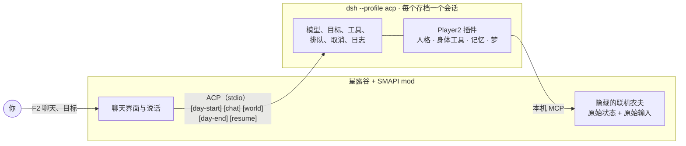

# DSH-Player2

<p align="center">
  <a href="README.md">English</a> · <b>简体中文</b>
</p>

<p align="center">
  
</p>

<p align="center">
  <strong>游戏里的 AI 第二玩家，从星露谷物语开始。</strong><br>
  Player2 是一位有自己人格的陪玩伙伴：在游戏原生界面里聊天，听你一句话就去做事，
  以自己的联机农夫身份下地干活，还记得你们一起过的每一天。
</p>

<p align="center">
  <a href="https://github.com/Alex-Yanggg/DSH-Player2/actions/workflows/ci.yml"></a>
  
  
  
  
  
  
</p>

## 这是什么

Player2 是基于 [DeepSeek Harness](https://github.com/dsh2026/test-Alex-Yanggg)（DSH）的游戏陪玩伙伴。它不是等你下指令的助手，而是一个知道自己想干什么的独立人格，你和它一起玩，就像和朋友联机一样。

同伴的“脑子”就是 DSH 自带 `acp` 配置下的一个普通会话，Player2 只是其中挂载的一个插件，从不分叉或修改 Harness。Player2 只补 DSH 没有的东西：人格、游戏里的身体（原始状态与原始输入）和记忆账本。

## 认识一下同伴

目前自带两位官方人格。每位都是一个角色包，可以复制一份改成你自己的（见 [personas/](personas)）。

| | 大肥鱼 | 军师 |
| --- | --- | --- |
| 是谁 | 理直气壮来蹭饭的胖鱼，你的农场搭子 | 话不多、冷静的参谋，靠得住 |
| 说话 | 慢吞吞、懒洋洋，三句不离吃；认真起来只说一句，但说到做到 | 冷淡、简短、平静，偶尔一句冷幽默，从不挖苦你 |
| 被派活时 | “行吧……干完能开饭吗？能的话我现在就去。” | “好。我去，天黑前回来。” |
| 口头禅 | “我就是来吃白饭的” | “先看清，再动手” |

每位人格有五个旋钮：话多少、求助倾向、冒险、听话程度、技术水平。做什么由模型决定，多久表现一次由带种子的骰子决定。

## 现在能做什么

| | 能力 | 现状 |
| --- | --- | --- |
| 💬 | 原生聊天 | F2 打开聊天窗口，可回滚、可调出上一句；同伴边想边说，一句一句出现。 |
| 🎯 | 一句话给目标 | “给我弄 3 根防风草”会变成 DSH 目标，同伴跨天去完成：自己找种子、开地、播种、浇水、按时睡觉。游戏暂停时目标保持不丢。 |
| 🧑‍🌾 | 自己的身体 | 同伴以隐藏的联机农场帮工身份加入你的存档，有自己的背包和虚拟手柄，整个窗口仍归你。 |
| 👀 | 感知 | 原始状态导出，加上它自己看不到的世界事件：你去睡了、受了重伤、钓到鱼、下到新的矿层。 |
| 😊 | 表达 | 联机原生表情、人格的语气和口头禅、关系弧线。 |
| 🌙 | 记忆与梦 | 它自己选择记住的片段、每晚重写的故事、性格与心情；还有一份可读的 `remember.md`。 |
| 🔓 | 作弊开关 | 默认关闭。作弊类输入需要 mod 设置打开，并且你在聊天里亲口允许。 |

## 怎么运作



mod 只是纯适配层：导出原始状态、注入原始输入，没有“走到某处”这类语义。导航、反射和目标循环在插件里，Harness 已经会的事都交给 DSH。详见 [docs/architecture.md](docs/architecture.md)。

## 快速开始

需要：

- 星露谷物语 + SMAPI 4.5+
- .NET 6 SDK
- Node.js 24.x
- 全局安装 DeepSeek Harness `0.2.0-rc.2`（`@deepseek-ai/dsh`），并设置 `DEEPSEEK_API_KEY`；Player2 只是插件，不自带运行时

安装依赖、跑一遍验证，再把插件加进 DSH 的 acp 配置：

```powershell
npm ci
npm run accept
dsh plugin --profile acp add ./packages/dsh-companion-plugin
```

在装了星露谷的 Windows 上构建并部署 mod：

```powershell
dotnet build .\stardew-mod\DSHPlayer2.Stardew.csproj --configuration Release -p:OS=Windows_NT
```

用 `StardewModdingAPI.exe` 启动游戏，读档、选一位同伴，按 **F2** 开聊。同伴和联机朋友一样需要农场上有一间小屋。更多见 [stardew-mod/README.md](stardew-mod/README.md)。

## 路线图

- [x] 每个存档一个 DSH 会话，走 ACP；mod 不自己记日志
- [x] 目标驱动：新存档春天“3 根防风草”从头跑通
- [x] 独立身体：隐藏的联机农夫
- [x] 角色包与两位明星人格
- [x] 逐句流式说话、世界事件、原生表情
- [ ] 更流畅：先量出发呆和卡住的时间，再补缺口（M0）
- [ ] 矿洞目标：下矿、打怪、把东西带回家
- [ ] 第一个预发布：许可证与 mod 安装包
- [ ] 用同一套协议接入第二个游戏
- [ ] 给社区用的角色工坊

## 边界

- **唯一的硬线：**Player2 不做第二个 Harness。模型、工具、目标、排队和日志都归 DSH，做游戏功能时绝不顺手改它。
- **当前不是重点：**无人值守刷田机器人、改存档、带反作弊的联网竞技游戏。
- **选择归人格。**除作弊开关外没有行为红线；产品负责把人格映射成真实动作，而不是事事先问再做。
- **还不支持星露谷的全部玩法。**

## 现状

本仓库处于预发布阶段：星露谷里已有可玩的纵切和完整的免密钥回归链，但还没有公开发布包，也还没选定许可证。变更记录见 [CHANGELOG.md](CHANGELOG.md)，开发规则见 [docs/operating-model.md](docs/operating-model.md)。
